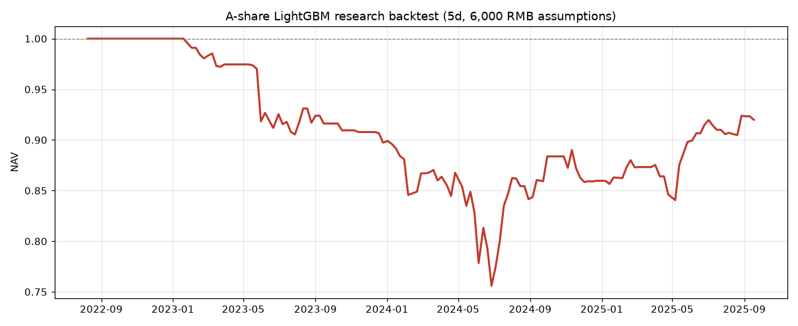

# A-Share ML Quant

A research pipeline for cross-sectional stock selection on the Chinese A-share market, built on LightGBM and price/volume factors.

> **Status: research code, not a profitable strategy.** The model shows weak but non-zero ranking power, and after realistic fees the backtest returns about **+1.85% annualised with a -31% maximum drawdown**. See Results below. Not investment advice.

## Overview

This project downloads daily bars for the full A-share market, builds 14 cross-sectional factors, trains a LightGBM ranking model, and runs an account-level backtest that models A-share specific constraints:

- T+1 settlement and 100-share lot sizes
- A 5 CNY minimum commission per trade
- Commission, stamp duty and transfer fee
- A short holding period (default 5 trading days)

## Architecture

| File | Role |
|---|---|
| `factors.py` | Shared factor and label definitions, used by both the backtest and signal generation |
| `fetch_all.py` | Downloads daily bars for the full A-share listing into parquet (resumable) |
| `pipeline.py` | Time-split backtest with purge/embargo, account-level simulation, IC report and a final candidate portfolio |
| `strategy.py` | Retrains on all labelled history and prints the latest candidate target portfolio |
| `verify.py` | Read-only audit of the dataset and output artifacts |

## Requirements

- Python 3.12
- Exact pinned versions are in `requirements.txt`

## Install

```bash
# with uv (recommended)
uv venv --python 3.12 .venv
uv pip install --python .venv/bin/python -r requirements.txt

# or with plain venv
python3.12 -m venv .venv
.venv/bin/pip install -r requirements.txt
```

## Usage

1. Download market data (roughly 5,100 stocks, resumable, takes a while):

```bash
python fetch_all.py
```

2. Run the backtest and print a candidate portfolio:

```bash
python pipeline.py
```

3. Generate the latest candidate list only:

```bash
python strategy.py --capital 6000 --names 4 --hold 5
```

4. Audit the dataset and artifacts:

```bash
python verify.py
```

Market data is intentionally not committed: the parquet file exceeds GitHub file size limits. Run `fetch_all.py` to rebuild it.

## Methodology

- **Signal timing.** Factors use only data up to the close of day t. Entry is modelled at the open of day t+1, exit at the close of day t+hold.
- **Split.** The train/test boundary is time ordered, then purged and embargoed by a full holding period so labels cannot overlap.
- **Normalisation.** Factors are cross-sectionally winsorised at 1%/99% and standardised using only the same signal date cross-section.
- **Costs.** Commission 0.025% (minimum 5 CNY), stamp duty 0.05% on sell, transfer fee 0.001%.

## Results

Out-of-sample window: signal dates 2023-04-21 to 2026-09-24, about 3.4 years.

| Metric | Value |
|---|---|
| IC mean | 0.0563 |
| IC std | 0.1157 |
| ICIR | 0.486 |
| Positive IC days | 71.3% |
| RankIC mean | 0.0651 |
| Total return | +6.46% |
| Annualised return | +1.85% |
| Maximum drawdown | -30.83% |
| Sharpe ratio | 0.21 |
| Rebalance intervals | 166 |
| Mean filled positions | 1.68 |
| Cumulative fees | 2967.51 CNY on a 6000 CNY account |

Annual returns:

| Year | Return |
|---|---|
| 2023 | -10.20% |
| 2024 | -2.86% |
| 2025 | +18.31% |
| 2026 | +3.15% |



## Key finding

At a 6,000 CNY account size the **account structure dominates the signal**. Two effects were measured directly:

1. **Position collapse.** With 10 target slots each slot holds 600 CNY, which cannot buy one 100-share lot of most A-share stocks. The realised average was **1.68 positions**, so the portfolio was effectively concentrated rather than diversified.
2. **Fee drag.** Cumulative fees reached **2967.51 CNY**, roughly half of the starting capital, driven by the 5 CNY minimum commission on small trades.

This is why the roadmap prioritises lower rebalance frequency, fewer but larger positions, and ETF instruments, rather than model architecture alone.

## Known limitations

- **Survivorship bias.** The universe is the currently listed set of stocks; delisted names are absent.
- **Execution assumptions.** Limit-up and limit-down fills, suspensions and slippage are not modelled.
- **Costs.** Stamp duty is applied uniformly, while the real rate changed in 2023.
- **Signal strength.** IC around 0.056 is weak and does not cover the cost structure at this account size.

## Roadmap

- Compare holding horizons (5 vs 20 vs 60 trading days) to quantify fee sensitivity.
- Add limit-up/limit-down and suspension filters to the backtest.
- Add a point-in-time universe including delisted stocks.
- Evaluate ETF rotation as a lower-cost alternative at small account sizes.

## License

MIT. See `LICENSE`.
